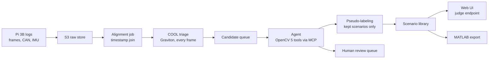
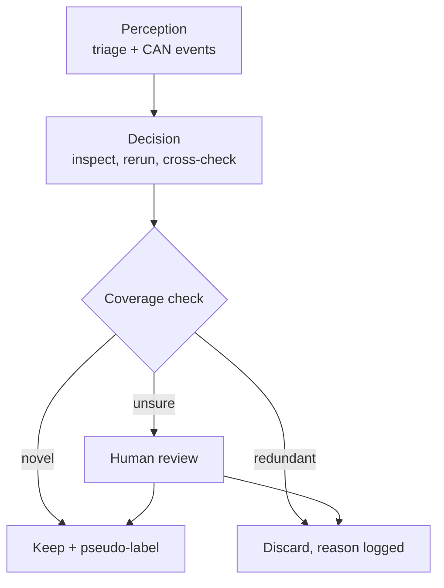

# Initiative Vision 1 — Phase 2 (Processing): Project Description

Sep 22, 2026 · @Someone

## Purpose and where this fits

Phase 2 turns logged drives from the Malibu into an autonomous-vehicle scenario library, processed in AWS with OpenCV 5 and COOL on Graviton. It is the cloud half of the Initiative Vision entry to the OpenCV AI Competition 2026, due Oct 26, 2026.

This is a scope and intent brief, not a sprint plan. Sprint objectives and tasks get defined from it.

- **Phase 1 (Acquisition):** on-vehicle, Raspberry Pi 3B. Frames, CAN, GPS, IMU, each independently timestamped. No processing.
- **Phase 2 (Processing, this document):** AWS. Aligns the streams, finds AV-relevant scenarios, pseudo-labels them, and exports them for perception and controls work.

The only contract between the phases is clean, timestamped data on a shared clock.

## Framing: AV scenario mining

The system mines a real drive for the rare moments that matter to autonomous vehicles and packages them with synced vehicle state. This is scenario mining (edge-case mining), the problem AV data teams pay to solve: most driving footage is uneventful, and finding the useful minutes is expensive.

The differentiator is the CAN bus. Most dashcam datasets have pixels only. Here, the driver's own inputs label the data: a hard brake or an unexplained swerve means something happened that an AV would also need to handle. The camera shows what it was; the vehicle bus shows how a human responded.

The car stays read-only. The agent acts on the data (what to inspect, keep, label, or escalate), never on the vehicle.

## Scenario taxonomy

Two families, each tagged with the signals that detect it. The taxonomy will grow; this is the starting set.

| Scenario | Family | Primary trigger | Corroboration |
| --- | --- | --- | --- |
| Faded or missing lane markings | Perception-hard | Lane-detection confidence drop | Steady steering (car still in lane) |
| Glare, low sun, night | Perception-hard | Brightness and exposure metrics | Time of day |
| Rain, poor visibility | Perception-hard | Blur and contrast metrics | Wiper signal, if found on CAN |
| Construction zone | Perception-hard | Segmentation (cones, barriers) | Speed drop |
| Occlusion | Perception-hard | Large near-field object in depth map | Motion mask |
| Road hazard (pothole, debris) | Perception-hard | Road-region anomaly score | IMU z-axis spike, evasive steer |
| Hard braking | Behavior-relevant | Wheel-speed deceleration | Object ahead in frames |
| Evasive steering | Behavior-relevant | Steering/yaw not explained by road curvature | Visual anomaly ahead |
| Lane change | Behavior-relevant | Steering pattern + lateral lane shift | Lane-line crossing in frames |
| Sharp curve | Behavior-relevant | Sustained yaw rate | Lane curvature |
| Stop-and-go | Behavior-relevant | Speed oscillation near zero | Vehicles ahead |
| Merge | Behavior-relevant | Lane change + speed change | Adjacent vehicle in frames |

A separate tag, **good for system ID**, marks segments with enough steering excitation to fit vehicle dynamics (see the MATLAB section).

## Pipeline architecture

Data flows one way: Pi to S3, alignment, cheap triage on everything, expensive reasoning only on candidates.

Each stage reads from the previous stage's output in S3, so any stage can be rerun alone. The web UI shows scenarios, pseudo-label panels, the agent's trace per decision, and the review queue.

## The agentic loop

Visual and vehicle evidence changes the agent's next tool call, what it keeps, and when it asks a human. That is the Agentic Vision qualifying condition; a chatbot explaining a fixed result would not qualify.

1. **Perception (triage, every frame).** Undistort with the IMX219 intrinsics, image-quality checks, lane-detection confidence, scene brightness. In parallel, scan CAN for brake spikes and steering/yaw deviations. Drop stationary frames using wheel speed. Output: candidate events with timestamps.
2. **Decision (per candidate).**
   - Pull a frame window around the event (at 30 fps, one event spans dozens of frames) and run heavier OpenCV 5 tools.
   - If frames are dark or blurry, rerun with different preprocessing (CLAHE, different ROI) before judging.
   - Pull the CAN and IMU window for the same timestamp and cross-check.
   - Classify the scenario and trim the window.
3. **Coverage-driven curation.** Before keeping a scenario, check what the library already holds. A 41st clear-daylight highway clip is skipped; a third night clip with faded lanes is kept at full frame rate. The library's current state changes what gets kept next.
4. **Action.** Keep (write a scenario record and queue pseudo-labeling), discard with the reason logged, or escalate to the human review queue with evidence when confidence is middling.

Every tool call and decision is written to a trace. The trace covers the observability and "show a trace" requirements and is shown per scenario in the UI.

## Pseudo-labeled output (LFG-style)

Each kept scenario gets a synced four-panel view modeled on Applied Intuition's [LFG research](https://www.appliedintuition.com/research-blog/label-free-autonomy-pretraining). LFG uses existing models as teachers to pseudo-label unlabeled dashcam video, then trains a student model. Phase 2 does the teacher half only; training a student is out of scope for the hackathon and the report will say so.

| Panel | Method | Runs on |
| --- | --- | --- |
| RGB | Undistorted frame | COOL |
| Depth | Small monocular depth model, ONNX via OpenCV 5 DNN | Graviton (COOL coverage to verify) |
| Semantics | Lightweight segmentation model (MobileNet-class): road, vehicle, person, sky | Graviton (COOL coverage to verify) |
| Motion mask | Dense optical flow minus ego-motion flow | OpenCV 5 |

**Ego-motion advantage.** LFG must infer camera motion from pixels. Here it is measured: wheel speed and yaw rate from CAN give the car's motion between frames. Subtracting the flow that motion explains leaves independently moving objects.

**Built-in accuracy check.** Rotation estimated from video (essential matrix between frames) is compared to CAN yaw rate. The error is a perception metric with free ground truth.

**Compute budget.** Depth and segmentation run only on scenarios the agent keeps, so the agent's decisions control where expensive compute goes.

## COOL and award targeting

One architecture targets the main prizes plus both special awards: COOL does bulk triage, the agent spends expensive attention only where triage flags something.

| Award | What qualifies it here | Evidence to produce |
| --- | --- | --- |
| Agentic Vision | Vision and CAN evidence change tool calls, curation, and escalation | Agent workflow diagram, decision traces, task success and failure handling |
| Best Use of COOL | Triage (undistort, resize, color conversion, filtering) runs on Graviton via COOL | COOL version, instance config, frames/s and $/drive-hour vs stock OpenCV on x86 |
| Placement prizes | Full submission quality | Report, repo with pinned deps, architecture diagram, endpoint, 5-minute video |

The COOL benchmark compares a Graviton instance running COOL against a comparable x86 instance running stock OpenCV on the same drives. Whether COOL accelerates DNN inference (depth, segmentation) is unverified; claim only what is measured.

## Evaluation plan

The headline result: at equal storage budget, the agent captures far more rare scenarios than uniform random sampling.

| Metric | Method | Ground truth |
| --- | --- | --- |
| Scenario detection precision and recall | Agent output vs labels on held-out drives | Hand-labeled scenario windows on 2–3 repeatable routes |
| Curation efficiency | Rare scenarios captured per GB, agent vs uniform random sample | Same labels |
| Value of CAN cross-check | Precision and recall with vs without CAN/IMU corroboration | Same labels |
| Ego-motion accuracy | Video-estimated rotation vs CAN yaw rate | CAN yaw rate |
| COOL performance | Frames/s and $/drive-hour, Graviton+COOL vs x86 baseline | Benchmark runs |

Hand-labeling is real work and is scheduled explicitly. Failure cases (missed scenarios, false keeps, bad pseudo-labels at night) go in the report, as the rules require.

## MATLAB tie-in: 3DOF vehicle model

The scenario library feeds the MATLAB/Simulink 3DOF model (PID longitudinal, LQR/MPC lateral) in three ways. None is required for the Oct 26 submission; replay validation could add one figure to the report, the rest follows the hackathon.

1. **System identification.** Fit front and rear cornering stiffness (and possibly yaw inertia) by driving the model with logged steering and speed and minimizing yaw-rate error. Use `greyest` (System Identification Toolbox) or `lsqnonlin` around the existing model. Mass and axle distances come from specs.
   - CAN gives steering *wheel* angle; the model needs road-wheel angle. Steering ratio and front cornering stiffness trade off in the fit, so fix the ratio from the spec sheet or a steady-state circle test.
   - Lateral velocity is not measured. IMU lateral acceleration constrains it.
2. **Replay validation.** Run the identified model open-loop on held-out drives with real inputs and report a normalized fit on yaw rate. Use only segments tagged good for system ID; highway cruising has too little excitation.
3. **Closed-loop controller testing.** Reconstruct each scenario's path by dead-reckoning speed and yaw rate (fine over 10–30 s windows; vision lane geometry can refine it). Run the controller tracking that path at the logged speed profile and compare its steering with the human's in the same scenario.

**Data handoff.** Export each scenario as CSV or `.mat`, load into a `timetable`, and `retime` onto a common time base (CAN is asynchronous, frames are 30 Hz). Feed Simulink through From Workspace blocks.

## Implications for Phase 1

Phase 2 raises the stakes on three Phase 1 decisions.

- **CAN is the most important sprint.** Steering, yaw rate, and wheel speed drive behavior-scenario detection, ego-motion, and every cross-check.
- **IMU moves from stretch to in-scope.** It confirms road hazards and hard braking and constrains lateral velocity for system ID. A cheap IMU is roughly an afternoon of integration.
- **One clock for all streams.** Cross-checks need frame and CAN timestamps aligned to about a millisecond. The Pi 3B has no RTC, so choose the clock source deliberately in the frame-capture sprint.
- **Camera intrinsics.** Confirm whether the IMX219 is an AutoDrive unit with known intrinsics; otherwise calibrate early. Undistortion and ego-motion depend on it.

GPS stays optional: useful for the map view, not needed by the loop.

## Timeline to Oct 26

Five weeks from Sep 22, with Phase 1 unfinished. Week 5 is buffer on purpose.

| Week of | Focus | Done when |
| --- | --- | --- |
| Sep 22 | Finish Phase 1: frame capture, CAN, IMU, shared clock | All three streams log on one clock |
| Sep 29 | Drive 2–3 repeatable routes; hand-label scenarios; COOL triage + x86 benchmark | Labeled set exists; benchmark numbers recorded |
| Oct 6 | MCP tool server, agent loop, traces, coverage curation | Agent processes a full drive end to end |
| Oct 13 | Pseudo-labeling panels, web UI endpoint, evaluation runs | Metrics table filled; endpoint live |
| Oct 20 | Report, architecture diagrams, 5-minute video, deploy | Submitted by Oct 26 |

**Cut order if behind:** GPS and map view, then the motion-mask panel, then MATLAB replay validation. Protect the agent loop, the CAN cross-check, and the evaluation; those are what judges score.

## Out of scope and open questions

**Out of scope for Phase 2 (hackathon):**

- Training a student model on the pseudo-labels
- Any vehicle actuation, including PSCM steering commands
- On-device inference
- The BLE companion app (separate track)
- Full system identification and closed-loop controller testing (post-hackathon)

**Open questions:**

- [ ] Does COOL accelerate DNN inference, or only classic OpenCV operations?
- [ ] Which small depth and segmentation models export cleanly to ONNX and run in the OpenCV 5 DNN module?
- [ ] Which LLM and MCP setup runs the agent, and where is it hosted in AWS?
- [ ] Is GPS via OnStar on CAN usable, or is the map view dropped?
- [ ] Is a wiper or headlight signal available on CAN to corroborate weather and night scenarios?
- [ ] Which clock source do all Phase 1 streams share?
