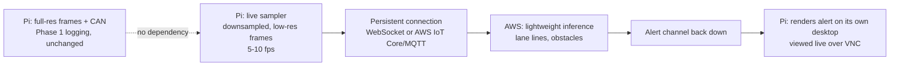

# Initiative Vision 1 — Phase 3 (Real-Time ADAS): Project Description

2026-09-23

## Purpose and where this fits

Phase 3 is an **optional, time-permitting stretch**, not part of the Oct 26 submission's required scope. Phase 1 (acquisition) and Phase 2 (offline processing, scenario mining) are the actual backbone of the entry; Phase 3 only gets attempted once those are solid and there's time left over. If it comes together, it's a live demo differentiator on top of an already-complete submission — not something the submission depends on.

- **Phase 1 (Acquisition):** on-vehicle, Raspberry Pi 3B. Frames + CAN, each independently timestamped, logged losslessly to disk. Already built.
- **Phase 2 (Processing):** AWS, offline. Aligns the streams, mines scenarios, pseudo-labels them. In progress.
- **Phase 3 (this document):** AWS, live. The Pi continuously uploads a lightweight stream over a phone hotspot; AWS runs cheap inference and pushes warnings back; the car surfaces them in near-real-time. A mini-ADAS demo, not a safety system — see "Non-goals" below.

Phase 3 adds a new path alongside Phase 1's existing full-res logging; it does not change or replace it. The full-res frames keep recording exactly as they do today, regardless of whether the live path is running.

## The bottleneck: round-trip latency, not acquisition speed

Phase 1 already proved 30 fps capture/encode is achievable on the Pi 3B at a sane resolution. That is not the constraint here. The constraint is the WAN hop: a phone hotspot's cellular link typically runs 50–150 ms round-trip under good signal, and spikes far higher under poor signal, before AWS inference time or the trip back are even counted.

**Working target: under ~2 seconds glass-to-alert is acceptable, under 500 ms is a bonus, not a requirement** (confirmed with you 2026-09-23 — "delayed or lagging behind by a second or two is acceptable"). This significantly loosens the design constraints below: a persistent WebSocket/MQTT connection is still good practice, but simpler polling would likely also clear a 2-second bar, so it's no longer a load-bearing decision. Still worth measuring rather than assuming — the first thing built here should be a latency-measuring harness, before any ADAS logic, so later choices are judged against real numbers.

## Architecture

Two deliberate choices worth calling out:

1. **A separate, small, low-rate stream for live inference — never the full-res logging path.** Full-res frames stay exactly as Phase 1 built them (lossless, disk-only, for later training data). The live path sends its own aggressively downscaled frames (e.g. 320×240) at a lower rate than capture (5–10 fps is probably enough — see the latency budget above). This keeps the WAN hop cheap and means the two goals never compete for bandwidth or CPU.
2. **A persistent connection, not per-frame HTTP.** Repeated TCP/TLS handshakes per frame add latency that's pure waste on an already-variable cellular link. Given the relaxed ~2s latency budget (see above), this is now a nice-to-have rather than load-bearing — but still the simpler thing to build correctly once, so still the default: a WebSocket or AWS IoT Core (MQTT) gives a duplex channel, frames up and alerts down on one connection.

**Worth deciding early: does lane departure need the cloud round-trip at all?** Classical lane detection (Canny edges + a region-of-interest mask + Hough line transform) is cheap enough that the Pi 3B could plausibly run it locally, skipping the WAN hop entirely for arguably the single most latency-sensitive feature. If that holds up under measurement, the architecture splits: lane departure runs on-Pi (near-zero latency), while the cloud path is reserved for the genuinely GPU/model-shaped work (obstacle and pedestrian detection). This is exactly the "make it work first" instinct — try the cheap local version before building the expensive networked one — and it directly attacks the one thing this whole phase is bottlenecked on.

## Feature list

| Feature | Fits current setup? | Approach |
|---|---|---|
| Lane departure warning | Yes | Classical CV (Canny + ROI mask + Hough lines) — candidate for running on-Pi, see above |
| Forward collision / following-distance warning | Yes | Bounding-box growth rate as a time-to-collision proxy (monocular, so less precise than stereo, but workable) |
| Obstacle detection | Yes | Lightweight cloud-side detector (small YOLO variant) |
| Pedestrian/cyclist detection | Yes | Same detector, called out as its own class rather than folded into generic "obstacle" — it's the highest-stakes miss, worth a dedicated confidence threshold and alert tone |
| Traffic sign recognition (stop signs, speed limits) | Yes, stretch-within-the-stretch | Classic CNN detection task, only attempted after the above are working |
| Blind-spot monitoring | **No** | Needs a camera pointed to the side/rear; out of scope without new hardware |
| Driver drowsiness/distraction | **No** | Needs a cabin-facing camera; out of scope without new hardware |

## Model and compute choices

- **Lane detection:** classical OpenCV, no trained model, candidate for on-Pi execution (see Architecture).
- **Obstacle/pedestrian detection:** a lightweight pretrained detector (small YOLO variant), served from a modest EC2 instance — **spun up only during actual test/demo windows**, not left running continuously, to conserve the AWS credit budget shared with Phase 2 (amount still to be confirmed, see open questions). Lambda's cold-start latency is a poor fit even for the relaxed ~2s budget above; SageMaker's a heavier lift than this needs.
- **Reuse with Phase 2:** the same lightweight models built here double as Phase 2's "cheap triage" stage (the Perception step in its agentic loop). This is a real argument for attempting Phase 3 even under time pressure — the model work isn't wasted if the live-demo integration doesn't fully land; it still improves Phase 2's triage.

## Alert delivery

**Decided 2026-09-23: VNC into the Pi, alert rendered on its own desktop.** No new hardware needed — `wayvnc` is already running on the Pi as a service (confirmed during the concurrent-load test on 2026-09-23). The Pi renders a simple full-screen or overlay window whenever an alert arrives (a colored banner via a plain OpenCV `imshow` window, or similar), and whoever's watching over VNC sees it live. Still only one WAN hop (AWS → Pi) either way — the VNC session itself, if viewed from a device also on the phone's hotspot network, doesn't add a second cellular round-trip.

## Non-goals

- **Not a certified or safety-grade ADAS system.** Framed and reported as a technology demo/prototype throughout — in code, in any submission materials, and in how it's described to judges. No claim of collision-avoidance reliability.
- **No vehicle actuation**, consistent with every other phase — this is warnings only, never steering/braking input. The car stays read-only, same as Phase 1 and Phase 2.
- **Not attempted before Phase 1 and Phase 2 are solid.** This is genuinely last in line.

## Timeline and cut-line

Phase 2's own timeline runs Sep 22 → Oct 26 with week 5 (Oct 20) held as buffer. Phase 3 only gets attempted if Phase 2's evaluation numbers and report are on track heading into that buffer week — this is week-5-or-never triage, matching Phase 2's own "cut order if behind" logic. Even a partial result (e.g. on-Pi lane detection alone, no cloud loop) is worth having as a submission-video clip; it doesn't need to be the full feature list to be worth showing.

## Open questions

- [x] **Alert output hardware:** VNC into the Pi, no new hardware — see "Alert delivery" above.
- [x] **Robustness bar:** confirmed 2026-09-23 — must be usable on an actual drive, not just a parking-lot demo, but a 1-2 second lag is acceptable. This is reflected in the relaxed ~2s latency target above.
- [x] **Throughput and latency measured for real, 2026-09-23** (Pi connected to the actual phone hotspot, `wlan0` 172.20.10.2/28): download ~1.4 MB/s (~11.2 Mbps), upload ~1.1 MB/s (~8.6 Mbps) via Cloudflare's speed-test endpoints. A 320×240 JPEG stream at even 10 fps (a few hundred KB/s) has 3-7x headroom under this — **bandwidth is not the constraint**, confirming the doc's original framing.
  **Latency is the real story, and it's worse and jitterier than assumed:** idle ping to 1.1.1.1/8.8.8.8 (30 pkts, 1s spacing, no self-congestion) averaged 111-202ms but swung as high as 545-796ms, with mdev around 100-200ms — huge inherent variance, likely this signal/location's normal behavior rather than anything our own traffic caused. A real HTTPS round-trip to `s3.us-east-1.amazonaws.com` (5 samples) ranged 415-716ms total. **Under a sustained 45s upload**, packet loss appeared where there was none at idle (0% → 6.7%), a real if modest degradation — RTT itself didn't get dramatically worse than the already-wide idle baseline. This is a single snapshot (one location, one time, one signal condition), not a permanent characteristic, but it's a realistic picture of the kind of variance to design for — and it validates the ~2s tolerance decision above: hitting sub-500ms consistently was probably never realistic on this link.
  **Data cap confirmed 2026-09-23: 35GB/month of high-speed data, then throttled (not cut off) after that.** Doing the math against the live stream's own footprint: 320×240 JPEG at 10fps (~4KB/frame) is ~40KB/s, ≈144MB/hour of live testing — a small fraction of the cap even under heavy use.
  **Confirmed the intended split, 2026-09-23:** full-session upload (Sprint 6) always goes over home Wi-Fi, no data cap there. The phone hotspot is reserved for Phase 3's live stream only — which was already the design here, and is now confirmed as the actual usage plan, not just an assumption. Flagged and resolved on `sprint-6-aws-upload.md` too, since its own bandwidth math (11-22GB/hour of driving) would have been a real problem against the 35GB cap if it had gone over the hotspot instead.
  **Bonus finding, relevant to Phase 2's region choice too:** of five AWS S3 regional endpoints tested (`us-east-1/2`, `us-west-1/2`, `eu-west-1`), `us-east-1` had the lowest one-shot latency (404ms) and, across 5 repeats, ranged 415-716ms — a reasonable candidate if no other constraint favors a different region.
- [ ] **AWS credit budget:** unknown ("let's find out"). I can't check this myself — no AWS credentials, per the Phase 2 "I drive, you prepare" arrangement. To check: AWS Console → **Billing and Cost Management** → **Credits** (shows remaining credit balance directly), and **Cost Explorer** or **Billing → Bills** to see what Phase 2 work has spent so far. Worth also setting up a **Budget** (Billing → Budgets → Create budget) with an email alert at, say, 75% of the $108 — cheap insurance against an always-on EC2 instance quietly draining the whole balance before Phase 2's own AWS work is done. Once you have the numbers, we can allocate: Phase 3's EC2 inference instance only needs to run during actual test/demo windows (see "Model and compute choices" above), so its realistic cost is probably small relative to Phase 2's — but "probably" isn't a number, worth confirming before committing time to building this.
