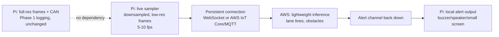

# Initiative Vision 1 — Phase 3 (Real-Time ADAS): Project Description

2026-09-23

## Purpose and where this fits

Phase 3 is an **optional, time-permitting stretch**, not part of the Oct 26 submission's required scope. Phase 1 (acquisition) and Phase 2 (offline processing, scenario mining) are the actual backbone of the entry; Phase 3 only gets attempted once those are solid and there's time left over. If it comes together, it's a live demo differentiator on top of an already-complete submission — not something the submission depends on.

- **Phase 1 (Acquisition):** on-vehicle, Raspberry Pi 3B. Frames + CAN, each independently timestamped, logged losslessly to disk. Already built.
- **Phase 2 (Processing):** AWS, offline. Aligns the streams, mines scenarios, pseudo-labels them. In progress.
- **Phase 3 (this document):** AWS, live. The Pi continuously uploads a lightweight stream over a phone hotspot; AWS runs cheap inference and pushes warnings back; the car surfaces them in near-real-time. A mini-ADAS demo, not a safety system — see "Non-goals" below.

Phase 3 adds a new path alongside Phase 1's existing full-res logging; it does not change or replace it. The full-res frames keep recording exactly as they do today, regardless of whether the live path is running.

## The bottleneck: round-trip latency, not acquisition speed

Phase 1 already proved 30 fps capture/encode is achievable on the Pi 3B at a sane resolution. That is not the constraint here. The constraint is the WAN hop: a phone hotspot's cellular link typically runs 50–150 ms round-trip under good signal, and spikes far higher under poor signal, before AWS inference time or the trip back are even counted.

**Working target: under 500 ms glass-to-alert**, end to end (frame capture → upload → inference → alert delivered). That's roughly human reaction time, so it's the threshold for the demo to *feel* real-time even though it isn't safety-certified real-time. Treat it as a number to measure against, not a number to assume — the first thing built here should be a latency-measuring harness, before any ADAS logic, so every later design choice is judged against real numbers instead of guesses.

## Architecture

Two deliberate choices worth calling out:

1. **A separate, small, low-rate stream for live inference — never the full-res logging path.** Full-res frames stay exactly as Phase 1 built them (lossless, disk-only, for later training data). The live path sends its own aggressively downscaled frames (e.g. 320×240) at a lower rate than capture (5–10 fps is probably enough — see the latency budget above). This keeps the WAN hop cheap and means the two goals never compete for bandwidth or CPU.
2. **A persistent connection, not per-frame HTTP.** Repeated TCP/TLS handshakes per frame add latency that's pure waste on an already-variable cellular link. A WebSocket or AWS IoT Core (MQTT) gives a duplex channel: frames up, alerts down, one connection.

**Worth deciding early: does lane departure need the cloud round-trip at all?** Classical lane detection (Canny edges + a region-of-interest mask + Hough line transform) is cheap enough that the Pi 3B could plausibly run it locally, skipping the WAN hop entirely for arguably the single most latency-sensitive feature. If that holds up under measurement, the architecture splits: lane departure runs on-Pi (near-zero latency), while the cloud path is reserved for the genuinely GPU/model-shaped work (obstacle and pedestrian detection). This is exactly the "make it work first" instinct — try the cheap local version before building the expensive networked one — and it directly attacks the one thing this whole phase is bottlenecked on.

## Feature list

| Feature | Fits current setup? | Approach |
|---|---|---|
| Lane departure warning | Yes | Classical CV (Canny + ROI mask + Hough lines) — candidate for running on-Pi, see above |
| Forward collision / following-distance warning | Yes | Bounding-box growth rate as a time-to-collision proxy (monocular, so less precise than stereo, but workable) |
| Obstacle detection | Yes | Lightweight cloud-side detector (small YOLO variant) |
| Pedestrian/cyclist detection | Yes | Same detector, called out as its own class rather than folded into generic "obstacle" — it's the highest-stakes miss, worth a dedicated confidence threshold and alert tone |
| Traffic sign recognition (stop signs, speed limits) | Yes, stretch-within-the-stretch | Classic CNN detection task, only attempted after the above are working |
| Blind-spot monitoring | **No** | Needs a camera pointed to the side/rear; out of scope without new hardware |
| Driver drowsiness/distraction | **No** | Needs a cabin-facing camera; out of scope without new hardware |

## Model and compute choices

- **Lane detection:** classical OpenCV, no trained model, candidate for on-Pi execution (see Architecture).
- **Obstacle/pedestrian detection:** a lightweight pretrained detector (small YOLO variant), served from a modest EC2 instance — **spun up only during actual test/demo windows**, not left running continuously, to conserve the $108 AWS credit budget shared with Phase 2. Lambda's cold-start latency is a poor fit for a sub-500ms budget; SageMaker's a heavier lift than this needs.
- **Reuse with Phase 2:** the same lightweight models built here double as Phase 2's "cheap triage" stage (the Perception step in its agentic loop). This is a real argument for attempting Phase 3 even under time pressure — the model work isn't wasted if the live-demo integration doesn't fully land; it still improves Phase 2's triage.

## Alert delivery

Recommend the Pi surfaces alerts itself (buzzer, LED, small screen, or speaker) rather than routing the alert back through the phone to somewhere else — that would be a second WAN hop this phase doesn't need. This needs a small hardware addition beyond what Phase 1 uses; see open questions.

## Non-goals

- **Not a certified or safety-grade ADAS system.** Framed and reported as a technology demo/prototype throughout — in code, in any submission materials, and in how it's described to judges. No claim of collision-avoidance reliability.
- **No vehicle actuation**, consistent with every other phase — this is warnings only, never steering/braking input. The car stays read-only, same as Phase 1 and Phase 2.
- **Not attempted before Phase 1 and Phase 2 are solid.** This is genuinely last in line.

## Timeline and cut-line

Phase 2's own timeline runs Sep 22 → Oct 26 with week 5 (Oct 20) held as buffer. Phase 3 only gets attempted if Phase 2's evaluation numbers and report are on track heading into that buffer week — this is week-5-or-never triage, matching Phase 2's own "cut order if behind" logic. Even a partial result (e.g. on-Pi lane detection alone, no cloud loop) is worth having as a submission-video clip; it doesn't need to be the full feature list to be worth showing.

## Open questions

- [ ] What's the phone hotspot's actual data plan/bandwidth situation — any cap that matters for a continuous low-res upload?
- [ ] What's available for Pi-side alert output (buzzer, small screen, speaker), or does something need to be bought?
- [ ] Does this need to survive an actual drive, or is "works reliably in a parking lot for the demo video" the real bar? This changes how much latency/robustness work is actually justified.
- [ ] Same AWS account/credit budget as Phase 2 — how much of the $108 is safe to earmark here versus reserved for Phase 2's EC2/inference needs?
